# Register for Classes: Interactive Prototype Specification

**HCI Case Study 2** by Kaden Donaldson, Weber State University

A medium-fidelity, fully interactive prototype of the class registration flow, built in semantic HTML5, CSS3, and vanilla JavaScript, plus the specification an engineering team would need to build it for real: input mapping, target sizing, component state matrices, semantic structure, ARIA hooks, and contrast verification.

| | |
|---|---|
| **Live prototype** | https://kaden-13.github.io/Registration-Prototype/ |
| **Component state gallery** | https://kaden-13.github.io/Registration-Prototype/states.html |
| **Run locally** | Open `index.html` in a browser, or run `python3 -m http.server` in this folder and visit `http://localhost:8000` |

---

## Contents

1. [Overview and selected flow](#1-overview-and-selected-flow)
2. [Step 1: Interaction mechanics and input paradigm mapping](#2-step-1-interaction-mechanics-and-input-paradigm-mapping)
3. [Step 2: Prototype and micro-interaction design](#3-step-2-prototype-and-micro-interaction-design)
4. [Step 3: Accessibility architecture and WCAG specification](#4-step-3-accessibility-architecture-and-wcag-specification)
5. [Step 4: Repository structure](#5-step-4-repository-structure)
6. [Post-mortem reflection](#6-post-mortem-reflection)

---

## 1. Overview and selected flow

### Background

My Phase 1 usability audit and Lab 03 cognitive audit both looked at Weber State's Register for Classes app. Two problems from that work drive this prototype:

1. **Keyboard users could not add classes.** Tabbing through the search results skipped the Add buttons and the listed classes entirely.
2. **Errors didn't say what happened.** Trying to register for a full class produced a vague error that never said the class was full.

Both are dynamic problems. A static wireframe of the results table looks fine; the failures only appear when someone presses Tab, or when the server answers with something other than success. That is why this case study specifies states and behavior, not just layout.

### Selected flow

One multi-step flow, end to end:

| Step | Screen | What the user does | What can go wrong |
|---|---|---|---|
| 1 | Choose term | Picks Spring 2027 | Continues with no term; tries a term that isn't open |
| 2 | Find classes | Searches by subject, filters, adds sections to My schedule | Bad course number, no subject, search service fails, no matches, section full, time conflict, duplicate course |
| 3 | Review and register | Checks the week grid, confirms charges, registers | Forgets the confirmation, double clicks Register, slow network |
| 4 | Results | Sees what registered | Another student took the last seat mid-request; user recovers with one click |

### How to try every state (for reviewers)

The prototype uses sample data and simulated server delays. Open **Prototype controls** in the footer to change the network speed, force a search failure, or turn the seat race on or off. The request counter there proves double submission is blocked.

| To see | Do this |
|---|---|
| Term error | Select Continue without picking a term |
| Field validation | Type `41` in Course number and select Search classes |
| Skeleton loading | Search any subject (skeletons appear after 100 ms) |
| Search failure and retry | Prototype controls > check "Class search fails to load", then search |
| Disabled with explanation | Press Add on CS 4110 section 003 (full) |
| Time conflict with fix | Add CS 4110 section 001, then Add CS 3100 section 001 |
| Duplicate course replace | Add CS 4110 section 001, then Add CS 4110 section 002 |
| Validation on submit | On Review, select Register without checking the box |
| Double submission blocked | Check the box, then double click Register. The counter shows 1 request |
| "Still working" message | Prototype controls > Simulated network: Slow, then register |
| Partial failure and recovery | Register with CS 4110 section 001 in the schedule (the seat race takes its last seat), then select Register for section 002 |

---

## 2. Step 1: Interaction mechanics and input paradigm mapping

### Interaction flow

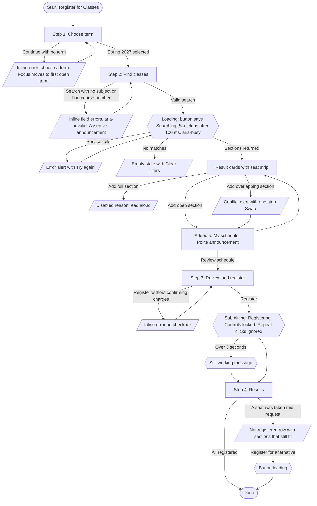

Static exports: [`prototype_spec/flows/interaction-flow.svg`](prototype_spec/flows/interaction-flow.svg) and [`.png`](prototype_spec/flows/interaction-flow.png). Hexagons are system processing states; slanted boxes are error or recovery states.

### Input paradigm map

Every action in the flow was checked against five ways of operating the page. Because every control is a native HTML element (`button`, `select`, `input`, `a`), the browser supplies keyboard, touch, and assistive technology behavior; the table records what the design adds on top.

| Action | Pointer (mouse, trackpad) | Touch (phone, tablet) | Keyboard | Screen reader (NVDA, VoiceOver) | Voice control (Voice Control, Dragon) |
|---|---|---|---|---|---|
| Skip header | n/a | n/a | Tab once, Enter on "Skip to main content" | Skip link is the first item read | "Click skip to main content" |
| Choose term | Click anywhere on the card | Tap anywhere on the 72 px card | Tab into group, arrow keys between open terms, Space selects | Hears "Spring 2027, radio button" plus the note; closed terms read as dimmed with their open date | "Click Spring 2027" |
| Pick subject | Click select | Native phone picker | Tab, then arrow keys or type to jump | Label "Subject" read; errors read as description | "Click Subject" |
| Course number | Click field | Numeric keypad opens (`inputmode="numeric"`) | Tab, type, Enter submits | Hint "4 digits, like 4110" read as description | "Click Course number", then dictate |
| Open filters | Click More filters | Tap (48 px tall) | Enter or Space | Hears "More filters, collapsed, button", then "expanded" | "Click More filters" |
| Search | Click Search classes | Tap (full width on phone) | Enter from any field, or Tab to button | "Searching for sections" then "10 sections found for Computer Science. 2 are full." | "Click Search classes" |
| Add section | Click Add on the card | Tap full-width Add | Tab reaches every Add button | Name includes the course: "Add CS 4110 section 002 to my schedule" | "Click Add" shows numbered overlays; name begins with the visible word "Add" (SC 2.5.3) |
| Learn why a section can't be added | Visible note under the button | Visible note | Focus stays on the button; reason is its description | Reason read on focus and again on press | "Click Add" on a full section reads the reason instead of failing silently |
| View My schedule | Always visible in the right column | Tap the bottom bar to open the sheet | Tab into the aside; Escape closes the sheet on phones | Complementary landmark "My schedule" | "Click My schedule" |
| Review and register | Click Review schedule, then Register | Tap | Tab, Space on checkbox, Enter on Register | Focus moves to the "Review and register" heading on arrival | "Click Register for 3 sections" |
| Recover from lost seat | Click Register for section 002 | Tap | Tab to button | Result summary announced, row says why it failed | "Click Register for section 002" |

**Gestures:** no swipe, drag, long press, or multi-finger gesture is required anywhere (WCAG 2.5.1). The phone schedule sheet opens with a tap, not a swipe.

### Fitts' Law target sizing

Fitts' Law says the time to hit a target grows with distance and shrinks with target size. The design applies it in three ways:

1. **Size floor.** Every control is at least 44 x 44 px, and the default height is 48 px (`--target: 48px`). Checkbox and radio targets are the whole label row or card, not the 22 px box.
2. **Predictable position.** On desktop every Add button sits in the same 200 px right column of its card, so the pointer travels straight down the column from one section to the next instead of hunting across a table row. On phones Add is full width, which makes horizontal accuracy irrelevant.
3. **Edges and separation.** The phone schedule bar is pinned to the bottom edge, inside the thumb zone. Destructive and committing actions are kept apart: Back to search and Register sit at opposite ends of the review form, and Remove never sits next to Register.

Measured results (smallest instance of each target across all screens; full table in [`prototype_spec/audits/target-size-audit.md`](prototype_spec/audits/target-size-audit.md)):

| Primary action | Desktop (px) | Phone (px) | Nearest neighbor gap | Result |
|---|---|---|---|---|
| Continue to class search | 247 x 48 | 358 x 48 | 36 px | Pass |
| Term option card | 640 x 97 | 358 x 123 | 12 px | Pass |
| Subject select / Course number | 288 x 48 / 222 x 48 | 324 x 48 | 16 px | Pass |
| Search classes | 169 x 48 | 324 x 48 | 8 px or more | Pass |
| More filters | 152 x 48 | 152 x 48 | 8 px | Pass |
| Filter checkbox rows | 730 x 50 | 344 x 50 | 8 px | Pass |
| Add section | 200 x 48 | 324 x 48 | 76 px (desktop) | Pass |
| Remove (schedule list, review list) | 84 x 44 | 324 x 44 | 24 px | Pass (minimum) |
| Review schedule | 298 x 48 | sheet, full width | 24 px | Pass |
| Confirmation checkbox row | 780 x 62 | 358 x 113 | 22 px | Pass |
| Register for N sections | 232 x 48 | 358 x 48 | 22 px | Pass |
| Register for alternative section | 210 x 44 | 210 x 44 | 258 px | Pass (minimum) |
| My schedule bar (phone) | n/a | 390 x 64 | edge pinned | Pass |

The only target under 44 px is the inline "Component state gallery" link inside a footer sentence, which WCAG 2.5.8 exempts.

---

## 3. Step 2: Prototype and micro-interaction design

### Build

- **Stack:** semantic HTML5, CSS3 (custom properties, `:has()`, `:focus-visible`), vanilla JavaScript. No framework, no build step, no tracking.
- **Type:** Atkinson Hyperlegible for body text (designed by the Braille Institute for low vision readers, with clearly different 0/O and 1/l/I shapes, which matters for section numbers like 001) and Bricolage Grotesque for headings. Both are self-hosted in `assets/fonts/`.
- **Signature element:** the seat strip. Each section draws one cell per seat, with open seats in green, so students can judge how full a class is at a glance. The words next to it ("1 seat left of 30") carry the same information for screen readers and anyone who can't see the color.
- **Files:** `index.html` (the flow), `states.html` (every component in every state), `assets/css/styles.css`, `assets/js/app.js`, `assets/js/data.js`.

### Component state matrix

Seven states were defined for every interactive component. "Visual" is what a sighted user sees; "Programmatic" is what the DOM and accessibility tree expose. A state that can't happen for a component is marked n/a with the reason.

#### Primary button (Continue, Search classes, Review schedule, Register)

| State | Visual | Programmatic |
|---|---|---|
| Default | Plum `#4C2A85`, white bold label, 48 px tall, 10 px radius | `<button type="submit">` |
| Hover | Darker `#3D2070` with a 2 px bottom edge | `:hover` |
| Focus | 3 px ink ring, 3 px offset | `:focus-visible` (keyboard only) |
| Active | `#2C1554`, inset shadow, moves down 1 px | `:active` |
| Disabled | Grey fill, dashed border, reason shown below ("Add at least one section to review.") | `aria-disabled="true"` + `aria-describedby` to the reason; stays in Tab order; press announces the reason |
| Loading | Label swaps to "Searching…" or "Registering…" with a spinner, in the same frame as the click | `aria-disabled="true"`, `.is-loading`, parent `aria-busy="true"`, polite announcement |
| Error | Red ring on the button plus the inline message on the field that caused it | Error placed on the field (`aria-invalid`), focus moved there, assertive announcement |

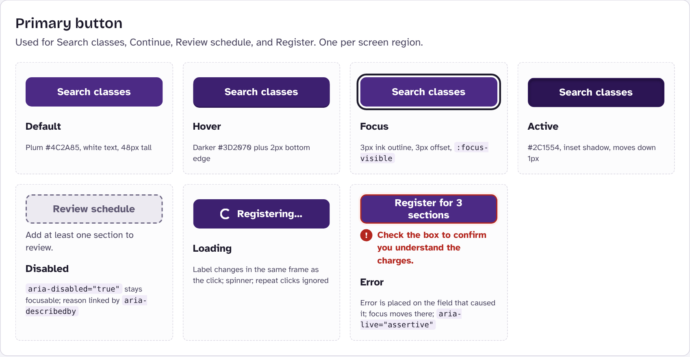

#### Add section button

| State | Visual | Programmatic |
|---|---|---|
| Default | Outlined plum with a + icon | `<button>` with hidden text: "Add CS 4110 section 002 to my schedule" |
| Hover | Fills plum | `:hover` |
| Focus | 3 px ink ring | `:focus-visible`; reachable by Tab (fixes the Phase 1 finding) |
| Active | Deep plum fill, 1 px press | `:active` |
| Disabled (full) | Grey, dashed border, × icon, note "Full. Seats open up when students drop." | `aria-disabled="true"`, `aria-describedby` to the note; press shows an inline error and announces it |
| Loading | n/a: adding to the schedule is local and finishes under 100 ms | Confirmation is a polite announcement with the new totals, and the button becomes Remove |
| Error (conflict) | Red inline alert naming both sections and times, with a one-step Swap button | Assertive announcement of the same text |

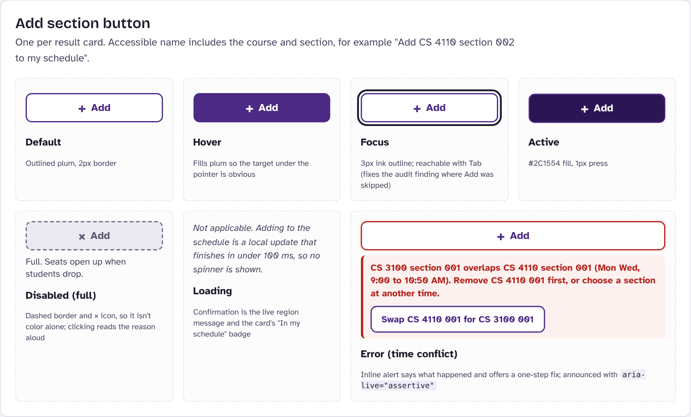

#### Text input and select

| State | Visual | Programmatic |
|---|---|---|
| Default | 2 px `#6F6985` border (5.20:1), 48 px tall | `<label for>`, hint in `aria-describedby` |
| Hover | Border darkens to ink | `:hover` |
| Focus | 3 px ink outline plus plum border | `:focus-visible` |
| Active | Light plum fill | `:active` |
| Disabled | Grey fill, dashed border | native `disabled` |
| Loading | Input: n/a. Select: shimmer and "Loading subjects…" if the list is fetched | `aria-busy="true"` |
| Error | Red border, pink fill, icon plus message under the field | `aria-invalid="true"`; message is in `aria-describedby`; focus moves to the first invalid field |

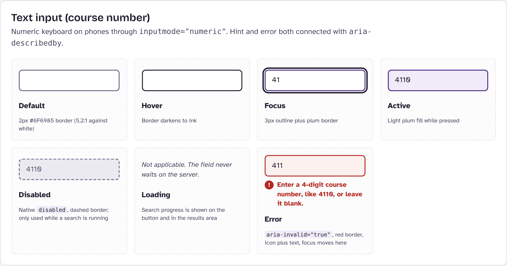
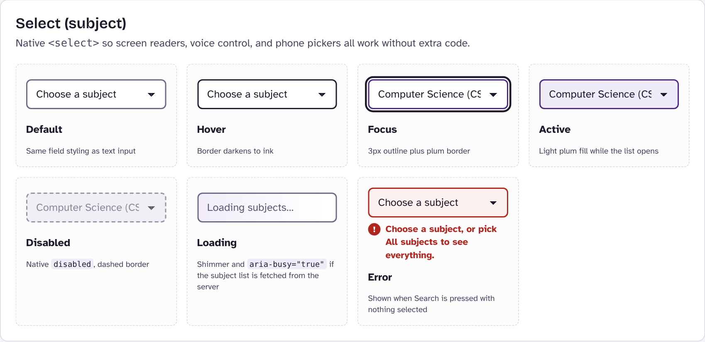

#### Checkbox row, disclosure toggle, term card, section card

| Component | Hover | Focus | Active | Disabled | Loading | Error |
|---|---|---|---|---|---|---|
| Checkbox row | Row tints plum | Ring around the whole row via `:has(input:focus-visible)` | Deeper tint | Locked while registering (`disabled`) | n/a: instant; form gets `aria-busy` | Red edge bar, message, `aria-invalid` |
| Disclosure toggle | Plum tint | 3 px ring | `aria-expanded="true"`, chevron turns, filter count shown | `disabled` during search | n/a: no server call | Panel opens itself if an error is inside it |
| Term card | Plum border and tint | Ring around the card | Double plum border, filled radio | Dashed card, "Not open", opening date | n/a: terms load with the page | Red card plus message, focus to first open term |
| Section card | n/a (not interactive itself) | n/a | "In my schedule" badge and plum edge | Full: red seat text, Add disabled | Skeleton cards after 100 ms, list `aria-busy` | "Sections didn't load" alert with Try again, `role="alert"` |

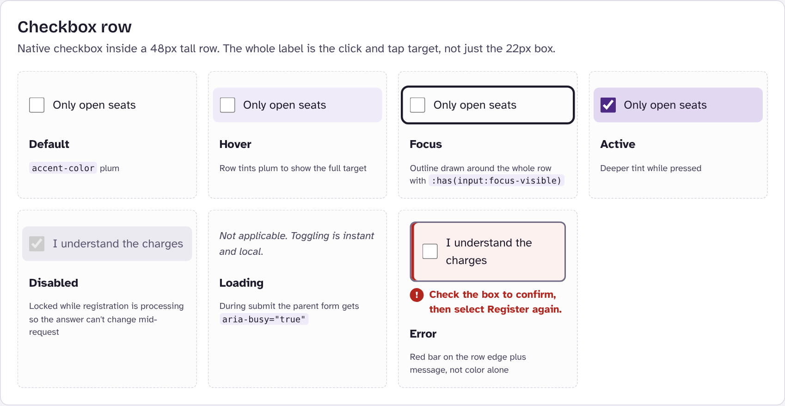
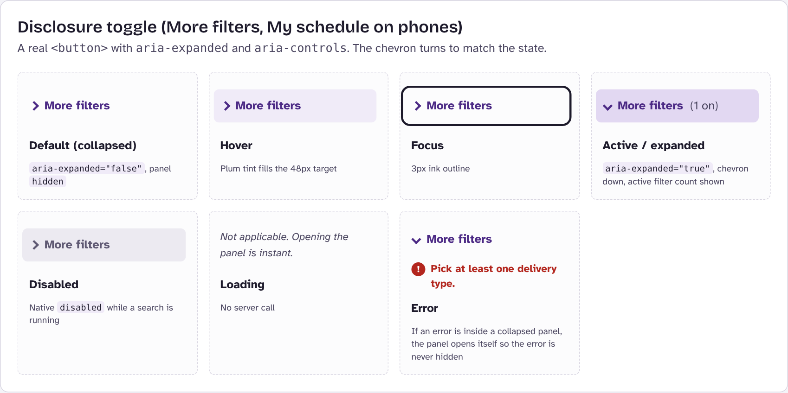
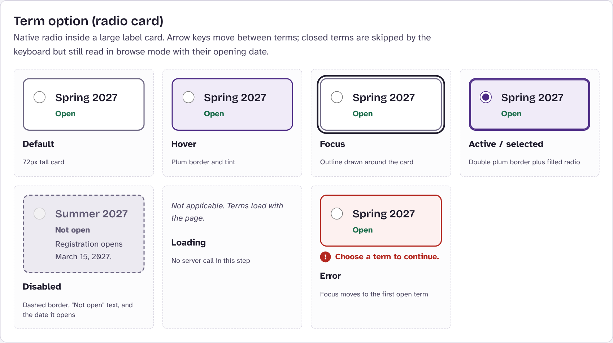
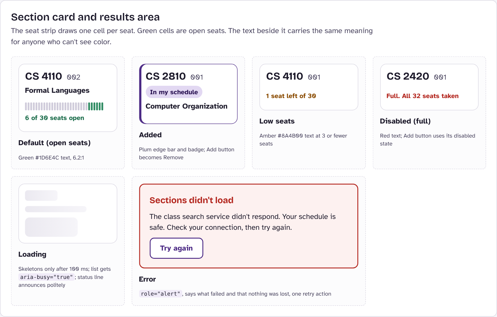

The same CSS rules power the gallery and the live prototype. Each state selector pairs the real pseudo-class with a helper class (for example `.btn:hover, .btn.is-hover`), so the documented state can't drift from the shipped one. See [`prototype_spec/code/06-component-states.css`](prototype_spec/code/06-component-states.css).

### Micro-interactions and latency feedback

| Trigger | Immediate feedback (same frame) | If the wait passes 100 ms | If it passes 3 s | Announcement |
|---|---|---|---|---|
| Search classes | Button: spinner, "Searching…"; status line "Searching for sections…" | Four skeleton cards replace the list | n/a (search finishes in about 3 s even on Slow) | Polite: result count and how many are full |
| Add section | Button becomes Remove; badge appears; schedule total updates | n/a | n/a | Polite: "CS 4110 section 002 added. 2 sections, 8 credits." |
| Register | Button: spinner, "Registering…"; Back, Remove, checkbox lock; status panel appears | Status panel pulses | Panel turns amber: "Still working. Keep this page open. Selecting Register again won't send a second request." | Polite at start and at 3 s; polite summary on results |
| Register for alternative | That button: spinner, "Registering section 002…"; sibling options lock | n/a | n/a | Polite: "CS 4110 section 002 registered." plus new summary |
| Step change | New step shown, scroll to top | n/a | n/a | Focus moves to the new `<h1>`; title and `aria-current` update |

All motion stops under `prefers-reduced-motion: reduce`; spinners become a static ring and the meaning stays in the text.

### Key screens

| Desktop | Phone |
|---|---|
| 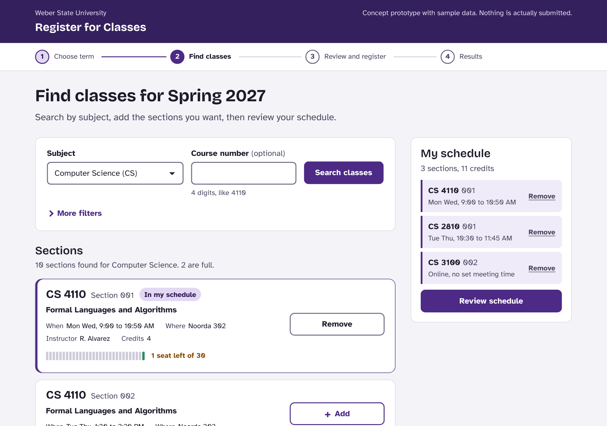 | 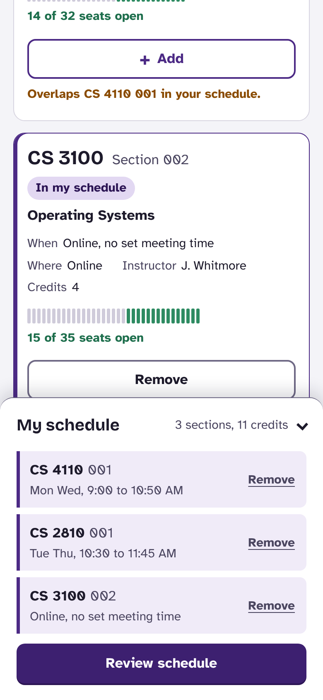 |
| 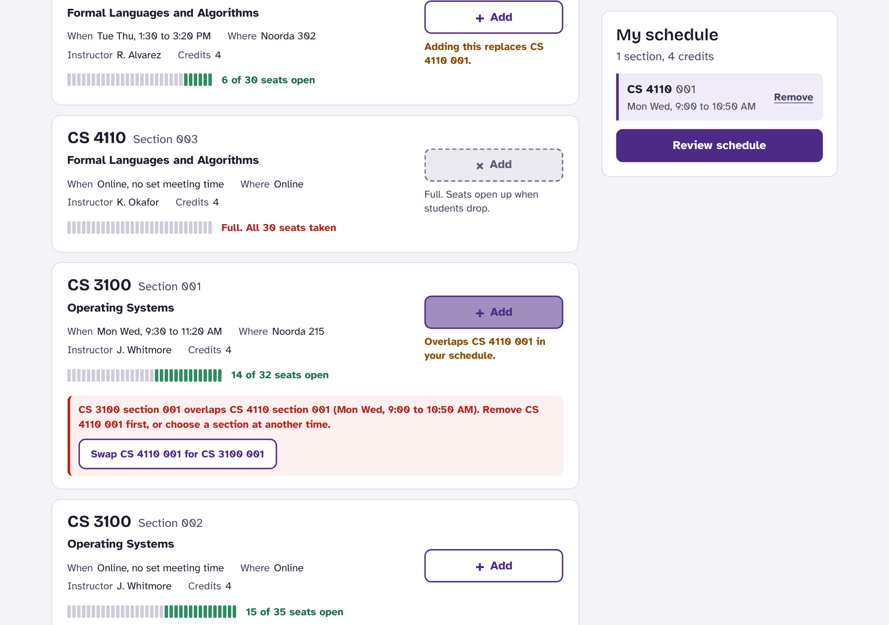 | 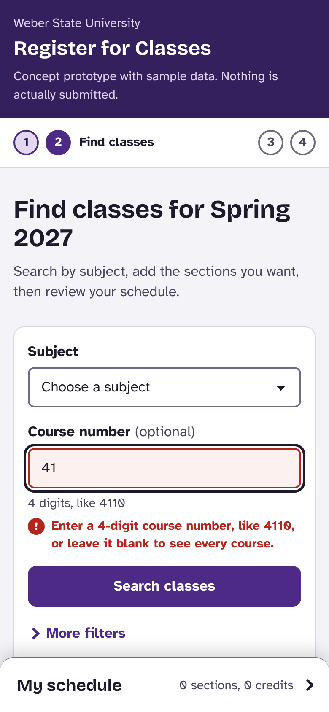 |
| 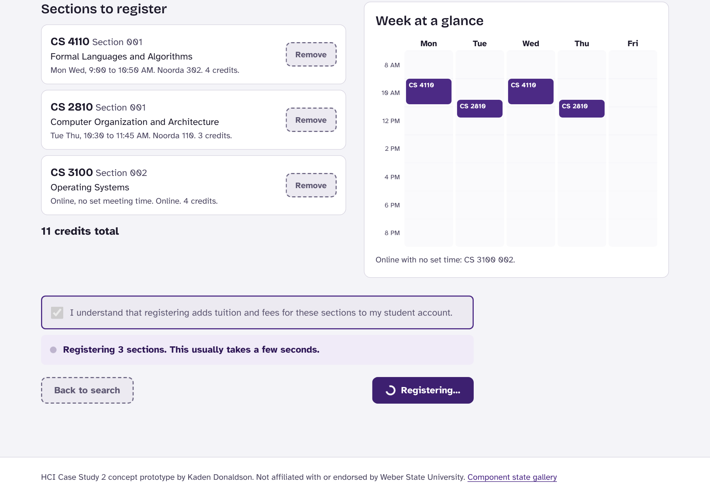 | 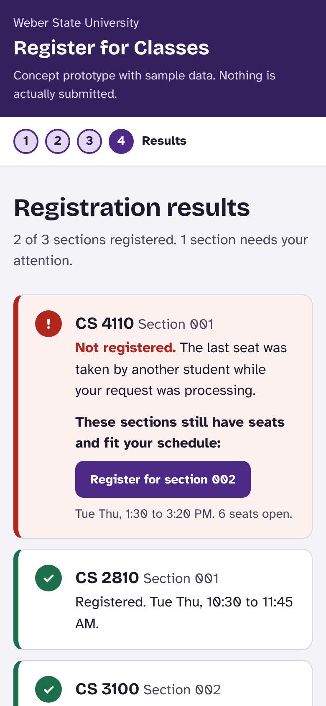 |

All 24 screens (desktop and phone, every step and error) are in [`prototype_spec/screens/`](prototype_spec/screens/).

---

## 4. Step 3: Accessibility architecture and WCAG specification

### Semantic HTML structure

Shared shell for every screen:

```html
<body>
  <a class="skip-link" href="#main">Skip to main content</a>
  <header class="site-header"> app name, prototype notice </header>
  <nav aria-label="Registration progress">
    <ol> <li aria-current="step">Choose term</li> … 4 steps </ol>
  </nav>
  <main id="main" tabindex="-1"> one visible <section> per step </main>
  <div id="sr-polite" aria-live="polite" aria-atomic="true"></div>
  <div id="sr-assertive" aria-live="assertive" aria-atomic="true"></div>
  <footer> credit, gallery link, prototype controls (disclosure) </footer>
</body>
```

Per screen:

```html
<!-- Step 1: Choose term -->
<section id="step-term" aria-labelledby="h-term">
  <h1 id="h-term" tabindex="-1">Choose a term</h1>
  <form id="term-form" novalidate>
    <fieldset aria-describedby="term-error">
      <legend>Term</legend>
      <input type="radio" name="term" …> <label>…</label>   <!-- x3, closed terms disabled -->
      <p id="term-error" class="field-error" hidden></p>
    </fieldset>
    <button type="submit">Continue to class search</button>
  </form>
</section>

<!-- Step 2: Find classes -->
<section id="step-search" aria-labelledby="h-search">
  <h1 id="h-search" tabindex="-1">Find classes for Spring 2027</h1>
  <form role="search" aria-label="Class search" novalidate>
    <label for="subject">Subject</label> <select id="subject">…</select>
    <label for="course-number">Course number</label> <input id="course-number" inputmode="numeric">
    <button type="submit">Search classes</button>
    <button aria-expanded="false" aria-controls="filters-panel">More filters</button>
    <div id="filters-panel" hidden>
      <input type="checkbox" id="open-only"> <label for="open-only">…</label>
      <fieldset><legend>Delivery</legend> 3 checkboxes </fieldset>
    </div>
  </form>
  <section aria-labelledby="h-results">
    <h2 id="h-results">Sections</h2>
    <p id="results-status" aria-live="polite"></p>
    <div id="results" aria-busy="false">
      <ul> <li><article aria-labelledby="…-title">
        <h3 id="…-title">CS 4110 Section 002</h3>
        <dl> When / Where / Instructor / Credits </dl>
        <p class="seat-text">6 of 30 seats open</p>
        <button>Add<span class="visually-hidden"> CS 4110 section 002 to my schedule</span></button>
      </article></li> … </ul>
    </div>
  </section>
  <aside aria-labelledby="h-cart">
    <h2 id="h-cart">My schedule
      <button aria-expanded="false" aria-controls="cart-body">…</button> <!-- phone only -->
    </h2>
    <div id="cart-body"> <ul> schedule items </ul> <button>Review schedule</button> </div>
  </aside>
</section>

<!-- Step 3: Review and register -->
<section id="step-review" aria-labelledby="h-review">
  <h1 id="h-review" tabindex="-1">Review and register</h1>
  <section aria-labelledby="h-review-list"> <h2>Sections to register</h2> <ul>…</ul> </section>
  <section aria-labelledby="h-week"> <h2>Week at a glance</h2>
    <div aria-hidden="true"> visual grid (the list above is the text version) </div>
  </section>
  <form id="register-form" novalidate aria-busy="false">
    <input type="checkbox" id="agree" aria-describedby="agree-error"> <label for="agree">…</label>
    <p id="agree-error" hidden></p>
    <div id="submit-status" hidden> status text </div>
    <button type="button">Back to search</button>
    <button type="submit">Register for 3 sections</button>
  </form>
</section>

<!-- Step 4: Results -->
<section id="step-done" aria-labelledby="h-done">
  <h1 id="h-done" tabindex="-1">Registration results</h1>
  <p id="done-summary">2 of 3 sections registered. 1 section needs your attention.</p>
  <ul> <li> status per section, alternatives as buttons </li> </ul>
</section>
```

Annotated versions with the reasoning behind each choice: [`prototype_spec/code/01-page-structure.html`](prototype_spec/code/01-page-structure.html).

### ARIA and screen reader hooks

| Attribute | Element | Values and when they change |
|---|---|---|
| `aria-expanded` | More filters, My schedule (phone), Prototype controls | `false` at load; toggles on press; validation forces `true` if an error is inside |
| `aria-controls` | Same toggles | ID of the panel they open |
| `aria-current="step"` | Progress list item | Moves on every step change |
| `aria-live="polite"` | `#sr-polite`, `#results-status` | Progress and confirmations |
| `aria-live="assertive"` | `#sr-assertive` | Validation errors, full section, time conflict |
| `aria-atomic="true"` | Both global regions | Whole message re-read, never a fragment |
| `aria-busy` | `#results`, `#register-form` | `true` while waiting on the server |
| `aria-invalid="true"` | Subject, Course number, Delivery fieldset, Agree checkbox | Set on failed validation; removed as soon as the user edits |
| `aria-describedby` | Fields, term radios, disabled buttons | Hint, error, or disabled reason |
| `aria-disabled="true"` | Full section Add, empty Review schedule, buttons while loading | Keeps the control focusable so its reason can be heard |
| `aria-labelledby` | Each step `<section>`, each result `<article>`, the aside | Names landmarks and cards by their headings |
| `aria-hidden="true"` | Seat strip, week grid, icons, step numbers | Decorative or duplicated in text |
| `role="search"` | Search form | Search landmark |
| `role="alert"` | Search failure box | Read immediately when it appears |

**Announcement script** (exact text, so QA can test with a screen reader):

| Event | Region | Message |
|---|---|---|
| Search with nothing selected | assertive | "1 error. Choose a subject, or pick All subjects to see everything." |
| Bad course number | assertive | "1 error. Enter a 4-digit course number, like 4110, or leave it blank to see every course." |
| Search starts | polite (status line) | "Searching for sections…" |
| Search done | polite (status line) | "10 sections found for Computer Science. 2 are full." |
| Section added | polite | "CS 4110 section 002 added. 2 sections, 8 credits." |
| Press Add on a full section | assertive | "CS 4110 section 003 is full, so it can't be added. Seats open up when students drop. Try another section of CS 4110." |
| Time conflict | assertive | "CS 3100 section 001 overlaps CS 4110 section 001 (Mon Wed, 9:00 to 10:50 AM). Remove CS 4110 001 first, or choose a section at another time." |
| Register without the box | assertive | "Error. Check the box to confirm you understand the charges, then select Register again." |
| Register starts | polite | "Registering 3 sections. This usually takes a few seconds." |
| Second press while registering | polite | "Still registering. Please wait." |
| 3 s elapsed | polite | "Still working. Keep this page open. Selecting Register again won't send a second request." |
| Results | polite | "2 of 3 sections registered. 1 section needs your attention." |

### Keyboard tab order

- **Order comes from the DOM.** Search form, filters, result cards top to bottom, My schedule, footer. A recorded Tab pass on the Find classes step hit 24 stops in that order with a visible focus ring on every one. Full log: [`prototype_spec/audits/keyboard-and-axe.md`](prototype_spec/audits/keyboard-and-axe.md).
- **No positive tabindex anywhere** (0 found by the audit script).
- **`tabindex="0"`:** every interactive widget is a native control, which already sits in the sequential Tab order with an implicit `tabindex="0"`. No custom widget (such as a clickable `<div>`) was needed, so no element needs `tabindex="0"` added by hand. The rule for future components: if a non-native element must be interactive, it gets `tabindex="0"`, a role, and key handlers for Enter and Space.
- **`tabindex="-1"`** is used only on programmatic focus targets: `<main>` (skip link), each step's `<h1>`, and result rows after recovery. They receive focus from script but are not Tab stops.
- **Focus is never lost.** After Add or Remove, focus stays on the same card's button. After removing from the schedule list, focus moves to the next Remove button. Escape closes the phone schedule sheet and returns focus to its toggle.

### Visual accessibility

Key contrast pairs (WCAG 2.1 formula on the exact hex values; all 31 pairs in [`prototype_spec/audits/contrast-audit.md`](prototype_spec/audits/contrast-audit.md)):

| Pair | Ratio | Needed | Result |
|---|---|---|---|
| Body text `#1D1A2B` on page `#F4F4F8` | 15.50:1 | 4.5:1 | Pass (AAA) |
| Secondary text `#4B4660` on white | 8.96:1 | 4.5:1 | Pass (AAA) |
| White on primary button `#4C2A85` | 10.62:1 | 4.5:1 | Pass (AAA) |
| Disabled label `#5F5973` on `#ECEAF1` | 5.57:1 | exempt | Pass anyway |
| Open seats `#1D6E4C` on white | 6.20:1 | 4.5:1 | Pass |
| Low seats `#8A4B00` on white | 6.80:1 | 4.5:1 | Pass |
| Error `#B3261E` on error fill `#FDF1F0` | 5.92:1 | 4.5:1 | Pass |
| Input border `#6F6985` on white | 5.20:1 | 3:1 | Pass |
| Focus ring `#1D1A2B` on white | 17.01:1 | 3:1 | Pass |
| Open seat cell `#2E8B62` on white | 4.21:1 | 3:1 | Pass |

Other checks:

- **Color is never the only signal.** Disabled uses a dashed border and × icon; errors use an icon, an edge bar, and words; seat status is written out.
- **Reflow:** at 320 px wide (the 400% zoom equivalent of a 1280 px window) the page has no horizontal scroll on any step.
- **Text spacing (SC 1.4.12):** with line height 1.5, letter spacing 0.12 em, word spacing 0.16 em, and paragraph spacing 2 em forced on, nothing clips or overflows at 320 px.
- **Forced colors:** borders, focus rings, and seat cells switch to system colors in Windows High Contrast.
- **Automated:** axe-core 4 (WCAG 2.0, 2.1, 2.2 AA and best practices) found **0 violations** on all four steps at desktop and phone widths and on the state gallery.

---

## 5. Step 4: Repository structure

```
Registration-Prototype/
├── README.md                     this specification
├── index.html                    the interactive prototype (4-step flow)
├── states.html                   component state gallery
├── .nojekyll                     serve files as-is on GitHub Pages
├── assets/
│   ├── css/styles.css            design tokens and every component state
│   ├── js/app.js                 flow logic, validation, latency, live regions
│   ├── js/data.js                sample terms and sections
│   └── fonts/                    self-hosted Atkinson Hyperlegible and Bricolage Grotesque
└── prototype_spec/
    ├── states/                   exported component state images (8)
    ├── screens/                  every flow screen, desktop and phone (24)
    ├── flows/                    interaction flow and state machines (.mmd source, .svg, .png)
    ├── code/                     annotated code snippets (6)
    └── audits/                   target size, contrast, keyboard and axe reports
```

### State machines

Register button:

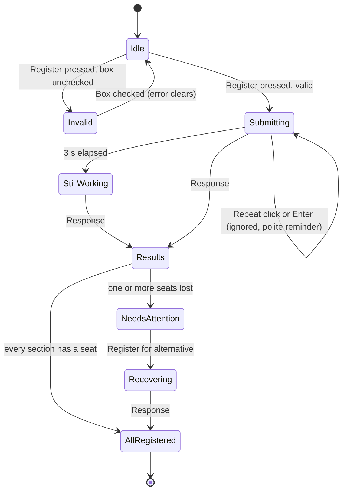

Search results area: [`prototype_spec/flows/search-states.svg`](prototype_spec/flows/search-states.svg)

### Annotated code

| File | Covers |
|---|---|
| [`01-page-structure.html`](prototype_spec/code/01-page-structure.html) | Landmarks, headings, fieldsets, labels, focus targets |
| [`02-disclosure.html`](prototype_spec/code/02-disclosure.html) | `aria-expanded` toggle pattern used three times |
| [`03-live-regions.js`](prototype_spec/code/03-live-regions.js) | Announcer function and every message, polite vs assertive rule |
| [`04-validation-and-disabled.js`](prototype_spec/code/04-validation-and-disabled.js) | Inline errors, `aria-invalid`, `aria-disabled` with reasons |
| [`05-latency-and-submit-guard.js`](prototype_spec/code/05-latency-and-submit-guard.js) | 100 ms skeleton threshold, 3 s message, three layer double submit guard |
| [`06-component-states.css`](prototype_spec/code/06-component-states.css) | State tokens shared by the gallery and the live prototype |

### Hosting on GitHub Pages

Repository Settings > Pages > Build and deployment: Source "Deploy from a branch", Branch `main`, folder `/ (root)`. The site appears at `https://kaden-13.github.io/Registration-Prototype/` within a minute or two.

### Traceability to Phase 1

| Phase 1 finding on the real page | Fix in this prototype | Where it's specified |
|---|---|---|
| Tab skipped the Add buttons and class listings | Every Add is a native `<button>` in DOM order with a unique accessible name | Keyboard tab order; Add button states |
| Registering for a full class gave a vague error | Full sections are marked before you try; pressing Add says it's full and what to do; a seat lost mid-request names the reason and offers sections that still fit | Add button disabled and error states; Results recovery |

---

## 6. Post-mortem reflection

### How did explicitly defining every component state during the specification phase prevent dynamic usability bugs that static wireframes completely fail to address?

A wireframe shows one moment: the resting state with good data. Almost every bug I found in the real registration system in Phase 1 lived somewhere else. Tabbing skipped the Add buttons, which is a focus problem you can't draw. The full class message was vague, which is an error state nobody had designed on purpose. Both look fine in a screenshot of the default page.

Writing out all seven states for each component forced me to answer questions a wireframe lets you skip. The first was the disabled Add button. My first instinct was the native `disabled` attribute, but once I had to fill in the "accessible fallback explanation" cell, I realized `disabled` removes the button from the Tab order. A keyboard or screen reader user would land on the next section and never learn why the full one was skipped, which is almost exactly the Phase 1 bug coming back in a new form. Switching to `aria-disabled="true"` with `aria-describedby` pointing at "Full. Seats open up when students drop." fixed it before any code shipped.

The loading column caught a second one. If the Register button only changed appearance after the server answered, there would be a 2 to 8 second window where it looked clickable, and an anxious student during a registration rush would click again. Defining the loading state as "label changes in the same frame as the click, button keeps focus but ignores presses" turned a likely double registration bug into a written requirement.

The focus column caught a third. Once Add turns into Remove, the old button no longer exists in the DOM, so focus would normally jump to the top of the page. Because I had to write down where focus goes for that transition, I made the re-render put focus back on the same card's new button.

It also made the hand-off concrete. Engineers can test against a table that says "`aria-invalid="true"`, message in `aria-describedby`, focus moves to first invalid field," while "make errors clear" is just an opinion. Because the gallery and the live prototype use the same CSS selectors, the documented states and the shipped states can't drift apart.

### Describe a scenario in your prototype where system latency or asynchronous data processing required specialized micro-interaction feedback. How does your design keep the user informed and prevent repeated submission errors?

The clearest case is the final Register step during a busy registration window. The request can take several seconds, and while it is in flight another student can take the last seat in a section the user wanted. The prototype simulates this: with CS 4110 section 001 in the schedule (1 seat left), the seat is taken mid-request.

The design handles it in layers:

1. **Instant acknowledgement.** On click, in the same frame, the button label changes to "Registering…" with a spinner, and a status panel appears saying "Registering 3 sections. This usually takes a few seconds." A polite live region announces the same text. That is well inside the 100 ms window where a response feels instant, so the user never wonders whether the click registered.
2. **Locked inputs.** Back to search, the Remove buttons, and the confirmation checkbox lock while the request runs, so the schedule being sent can't change halfway through. The form gets `aria-busy="true"`.
3. **Reassurance for long waits.** At 3 seconds the panel turns amber and says "Still working. Keep this page open. Selecting Register again won't send a second request." That speaks to the exact fear that causes repeat clicks and refreshes.
4. **Repeat submissions are absorbed.** A `submitting` flag drops every extra click or Enter press and answers with a polite "Still registering. Please wait." Each attempt also carries an idempotency key, so even a network-level retry could not register a student twice on a real server. In testing, double clicking Register sent exactly one request, and the counter in Prototype controls shows it.
5. **Partial failure is specific and recoverable.** When the response comes back, focus moves to the "Registration results" heading and the summary is announced: "2 of 3 sections registered. 1 section needs your attention." The failed row says plainly that the last seat was taken while the request was processing, which is the opposite of the vague error from Phase 1. It then lists only the sections of that course that still have seats and don't clash with what did register, each as a one-click button with its own loading state.

The search step uses a lighter version of the same idea. The button changes immediately, skeleton cards appear only if the wait passes 100 ms (so fast results don't flash), the results container is `aria-busy` so a screen reader doesn't read a half-built list, and the status line announces the count and how many sections are full once loading finishes.

The goal throughout was that the user should always know three things without guessing: that the system heard them, that it is still working, and what exactly happened when it finished.
